# RMUTI Dorm Finder

เว็บแอปค้นหาหอพักใกล้ **มหาวิทยาลัยเทคโนโลยีราชมงคลอีสาน วิทยาเขตขอนแก่น** รวมข้อมูลหอพัก ประเภทห้อง ราคา สิ่งอำนวยความสะดวก และจำนวนห้องว่างไว้ในที่เดียว พร้อมส่วนจัดการสำหรับเจ้าของหอพักและผู้ดูแลระบบ


> ภาพหน้าจอที่ติดป้าย “ภาพสาธิต” เป็น **ภาพจาก HTML templates และ JavaScript เดิม โดยใช้ข้อมูลตัวอย่างแทน API** ไม่ได้เชื่อมฐานข้อมูลหรือเรียก AI จริง ชื่อหอ ราคา สถิติ และข้อมูลบุคคลในภาพเหล่านั้นเป็นข้อมูลสมมติ รูปห้องนำมาจากไฟล์เดิมใน repository และไม่ได้ยืนยันว่าเป็นภาพของหอใด ส่วนภาพแชท AI เป็นภาพหน้าจอที่เจ้าของโปรเจกต์ส่งมา

## ทำขึ้นเพื่ออะไร

การหาหอพักต้องเปรียบเทียบหลายเรื่องพร้อมกัน ทั้งงบประมาณ ระยะทาง ห้องว่าง และสิ่งอำนวยความสะดวก โปรเจกต์นี้จึงออกแบบให้ผู้ค้นหาดูและเปรียบเทียบข้อมูลเหล่านี้ผ่านเว็บเดียว เจ้าของหอพักอัปเดตข้อมูลของตนเองได้ และผู้ดูแลตรวจอนุมัติข้อมูลก่อนเผยแพร่

เป้าหมายคือช่วยให้นักศึกษาตัดสินใจเลือกหอพักได้สะดวกขึ้น พร้อมลดขั้นตอนการรวบรวมประกาศและรับคำขอจองของเจ้าของหอพัก

## ความสามารถหลัก

| ผู้ใช้งาน | สิ่งที่ทำได้ |
|---|---|
| นักศึกษา / ผู้ค้นหาหอพัก | ดูรายการหอ ค้นหาและกรองตามประเภท สิ่งอำนวยความสะดวก และระยะทาง เรียงตามราคา ยอดวิว หรือห้องว่าง ดูรูปและประเภทห้อง ข้อมูลติดต่อ และลิงก์แผนที่ ส่งคำขอจองโดยไม่ต้องสมัครบัญชี |
| เจ้าของหอพัก | สมัครและรออนุมัติ เข้าสู่ระบบ เพิ่มหรือแก้ไขหอพัก อัปโหลดรูป จัดการประเภทห้อง ราคาและห้องว่าง ดูสถิติยอดเข้าชม และจัดการสถานะการจอง |
| ผู้ดูแลระบบ | อนุมัติหรือปฏิเสธบัญชีเจ้าของหอ ตรวจประกาศและข้อมูลแก้ไข จัดการเจ้าของหอและหอพัก พร้อมดูสถิติภาพรวม |

ส่วน AI ใช้ Gemini ช่วยแปลงคำค้นภาษาไทยเป็นเงื่อนไข และตอบคำถามจากข้อมูลของหอพักที่เลือก โค้ดยังมีเส้นทาง semantic search ด้วย pgvector และการจัดอันดับผลลัพธ์ ซึ่งมีข้อจำกัดของเวอร์ชันเดิมตามหัวข้อสถานะโปรเจกต์ด้านล่าง

## เทคโนโลยีที่ใช้

<p>
  
  
  
  
  
  
  
  
</p>

| ส่วน | เทคโนโลยีและหน้าที่ |
|---|---|
| Frontend | HTML, Jinja2, Tailwind CSS และ Vanilla JavaScript แสดงหน้าจอ เรียก API ด้วย Fetch และรับแจ้งเตือนผ่าน WebSocket; ใช้ SweetAlert2 สำหรับกล่องแจ้งเตือน |
| Backend | Python 3.11, FastAPI, Uvicorn และ Pydantic ให้บริการหน้าเว็บ ตรวจข้อมูล และจัดการ API |
| Database | PostgreSQL 15, SQLAlchemy Async และ asyncpg จัดเก็บข้อมูล; pgvector รองรับเวกเตอร์สำหรับ semantic search |
| Cache และเหตุการณ์ | Redis 7 เก็บแคช active token และข้อมูล rate limiting พร้อม Pub/Sub ส่งเหตุการณ์ไปยัง dashboard |
| AI | Google Gemini: `gemini-2.5-flash` สำหรับ intent, reranking และ Q&A; `gemini-embedding-001` สำหรับ embedding ตามที่โค้ดกำหนด |
| Authentication | JWT ผ่าน cookie, python-jose และ bcrypt พร้อม password pepper แยกบทบาท owner / admin |
| Email | FastAPI-Mail ส่งอีเมลแจ้งผลผ่าน Gmail SMTP |
| Environment | Docker และ Docker Compose ประกอบบริการ backend, PostgreSQL และ Redis |

โลโก้เทคโนโลยีจาก [SVGL](https://svgl.app/) — ดู URL ต้นทางใน [logo-sources.json](docs/design/logo-sources.json)

## System Architecture

[เปิดแผนภาพบน Canva — หน้า 2: System Architecture — Whiteboard](https://www.canva.com/design/DAHY3t3zQZI/view)

[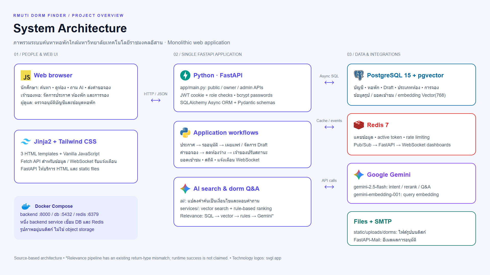](https://www.canva.com/design/DAHY3t3zQZI/view)

ระบบเป็น **Monolithic web application** มี FastAPI แอปเดียวให้บริการทั้ง HTML, static files, HTTP APIs และ WebSocket โดยแยกหน้าที่ภายในเป็นส่วนดังนี้

1. **หน้าจอเว็บ** — Jinja2 ส่ง HTML ให้เบราว์เซอร์ จากนั้น JavaScript โหลดรายการหอ รายละเอียด และข้อมูล dashboard ผ่าน API
2. **FastAPI** — ประมวลผลการค้นหา บัญชีผู้ใช้ การตรวจอนุมัติ ประเภทห้อง การจอง และยอดเข้าชม พร้อมตรวจ JWT และบทบาทในเส้นทางที่กำหนด
3. **PostgreSQL** — เก็บเจ้าของหอ ผู้ดูแล หอพัก ข้อมูลร่าง ประเภทห้อง การจอง ประวัติยอดวิว และชื่อไฟล์รูป ส่วนไฟล์รูปจริงอยู่ที่ `static/uploads/dorms/`
4. **Redis** — รองรับแคชและ rate limiting รวมถึงส่งเหตุการณ์ Pub/Sub ให้ FastAPI กระจายผ่าน WebSocket ไปยังหน้าผู้ดูแลและเจ้าของหอ
5. **Gemini และ SMTP** — Gemini ช่วยตีความคำค้นและตอบคำถามจากข้อมูลหอ ส่วน SMTP ส่งอีเมลแจ้งผลการอนุมัติ

เส้นทางค้นหาแบบ relevance ที่พบในโค้ดคือ `Gemini intent → SQL candidates → pgvector → rule ranking → Gemini reranking` ส่วนการค้นหาปกติใช้ตัวกรองและการเรียงข้อมูลโดยตรง

<details>
<summary>ภาพหน้าจอแผนภาพบน Canva Whiteboard</summary>

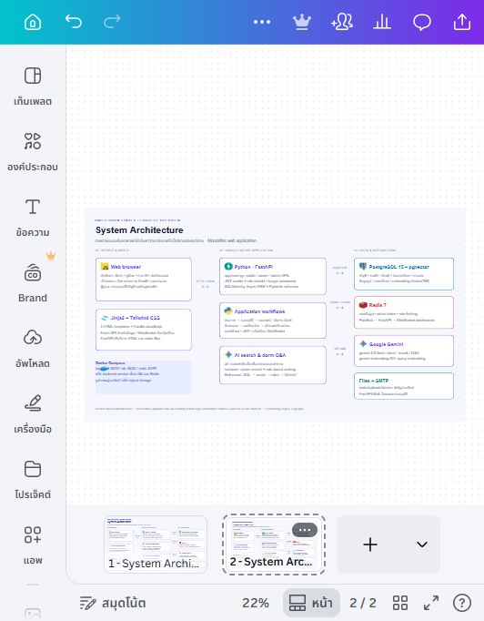

ดีไซน์มีหน้า 1 เป็นต้นฉบับที่นำเข้า และหน้า 2 เป็น Whiteboard ที่วางองค์ประกอบแก้ไขได้ ภาพสถาปัตยกรรมด้านบนเรนเดอร์จาก HTML ต้นฉบับเดียวกับที่นำเข้า Canva เพื่อให้อ่านได้ชัดบน GitHub

</details>

## User Flow

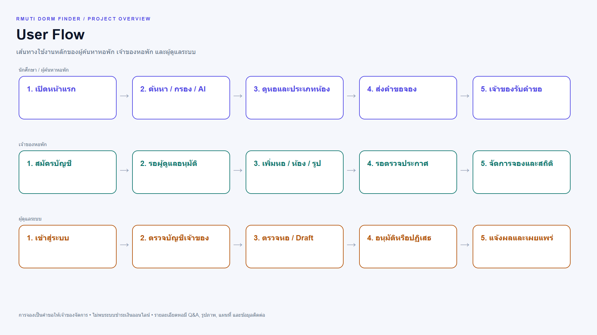

ผู้ค้นหาหอพักเริ่มจากเลือกหอและประเภทห้อง ก่อนส่งคำขอจองให้เจ้าของดำเนินการ เจ้าของต้องผ่านการอนุมัติบัญชีและส่งประกาศให้ผู้ดูแลตรวจ ส่วนการแก้ไขข้อมูลหอที่เผยแพร่แล้วมีขั้นตอนเก็บ Draft เพื่อรอพิจารณา

การจองในระบบเป็นการส่งคำขอและให้เจ้าของปรับสถานะ **ไม่พบการชำระเงินออนไลน์ในซอร์สเวอร์ชันนี้**

## ตัวอย่างหน้าจอ

ภาพที่ติดป้าย “ภาพสาธิต” ใช้ข้อมูลตัวอย่างและหน้าตาจากเทมเพลตเดิม ส่วนภาพแชท AI ได้รับจากเจ้าของโปรเจกต์

### ค้นหาและดูรายการหอพัก

ดูราคาเริ่มต้น จำนวนห้องว่าง ระยะทาง และเปิดรายละเอียดหอพัก

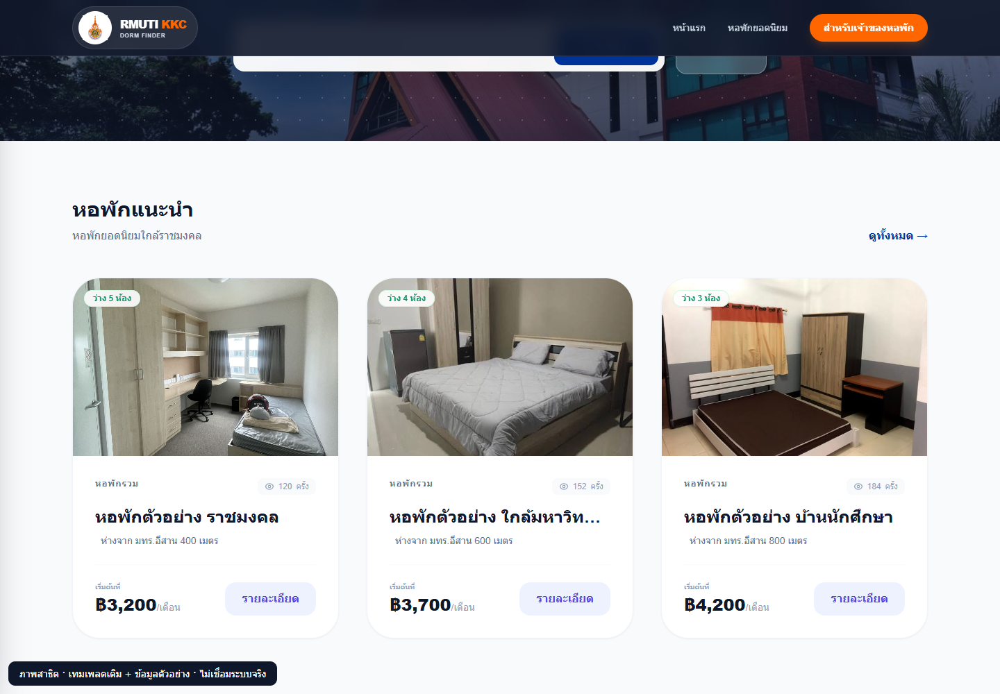

### รายละเอียดหอพักและประเภทห้อง

ดูแกลเลอรี สิ่งอำนวยความสะดวก ช่องทางติดต่อ และเลือกประเภทห้องที่สนใจ หน้ารายละเอียดมีจุดเข้าใช้งาน AI สำหรับถามเกี่ยวกับหอพัก

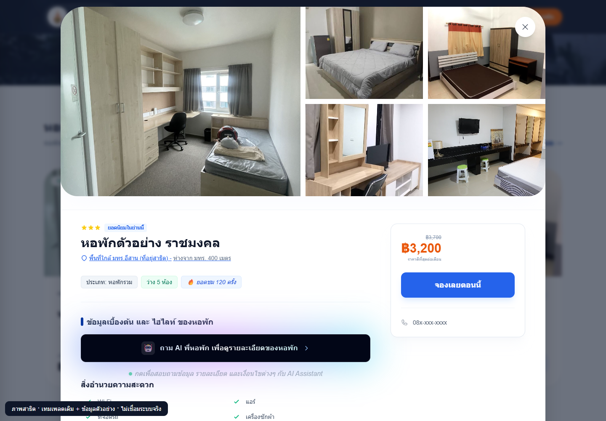
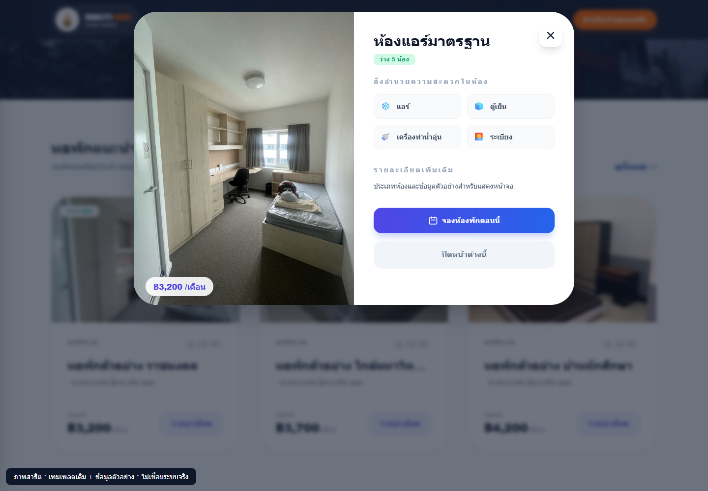

### ถาม AI เกี่ยวกับหอพักที่เลือก

เปิดแชทจากหน้ารายละเอียดหอพักเพื่อถามด้วยภาษาทั่วไป เช่น “มีห้องพักแบบไหนบ้าง” หรือ “มีสิ่งอำนวยความสะดวกอะไรบ้าง” ระบบส่งข้อมูลของหอพักนั้นและคำถามให้ Gemini ช่วยสรุปคำตอบ ทั้งประเภทห้อง ราคา และจำนวนห้องว่าง โดยกำหนดให้ตอบตามข้อมูลที่มีและแจ้งเมื่อไม่มีข้อมูล แชทจึงช่วยให้ผู้ค้นหาสอบถามรายละเอียดได้โดยไม่ต้องไล่อ่านทุกส่วนของประกาศ

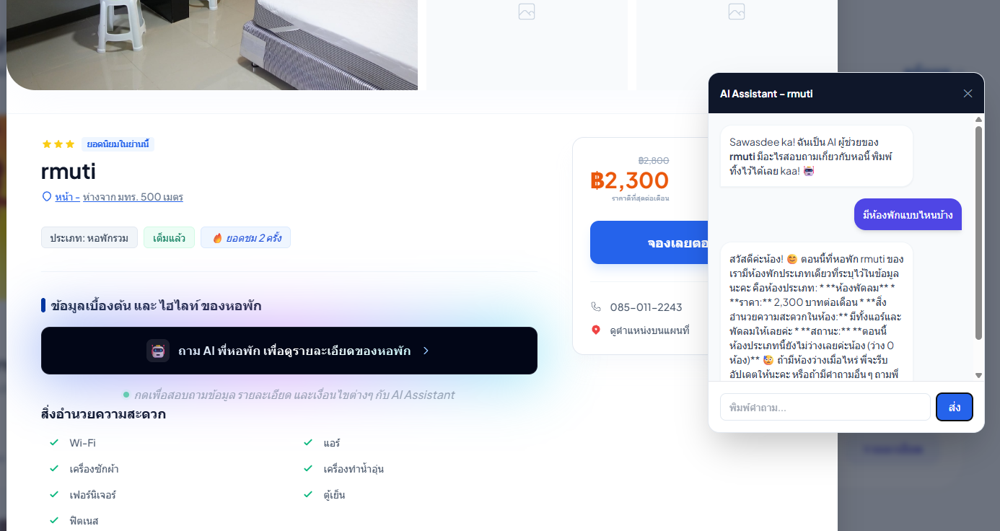

*ภาพหน้าจอจากเจ้าของโปรเจกต์ แสดงตัวอย่างการถามประเภทห้องพักของหอที่กำลังเปิดดู*

### ส่งคำขอจอง

ระบุชื่อ เบอร์โทร วันที่ต้องการเข้าอยู่ และหมายเหตุ เพื่อส่งคำขอให้เจ้าของหอพักจัดการ

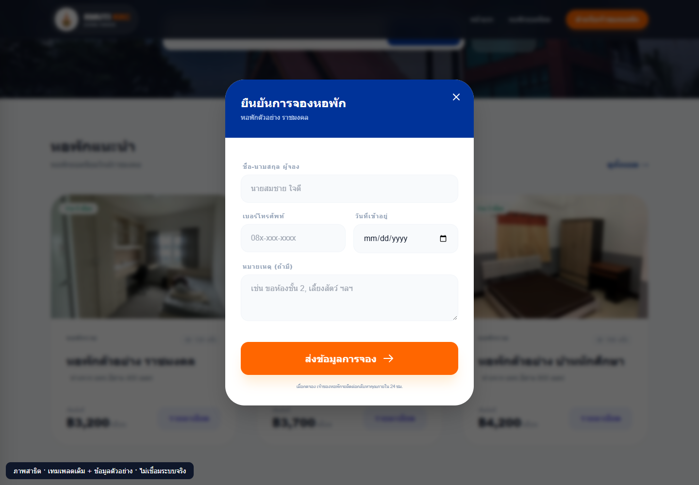

### จัดการหอพักสำหรับเจ้าของ

จัดการข้อมูลหอ ประเภทห้อง และจำนวนห้องว่าง พร้อมดูสถิติการเข้าชม

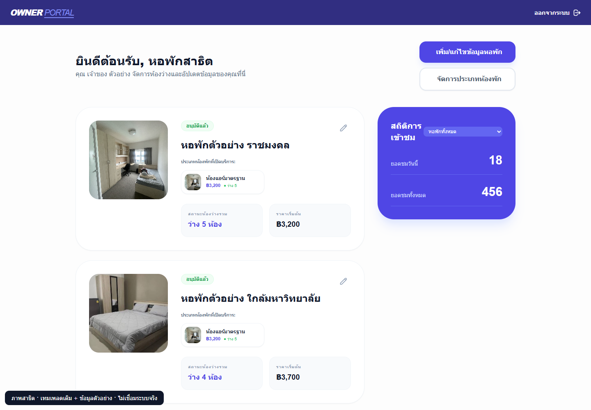

### ตรวจข้อมูลสำหรับผู้ดูแล

ตรวจบัญชีและประกาศที่รออนุมัติ พร้อมจัดการข้อมูลหอพักที่เผยแพร่

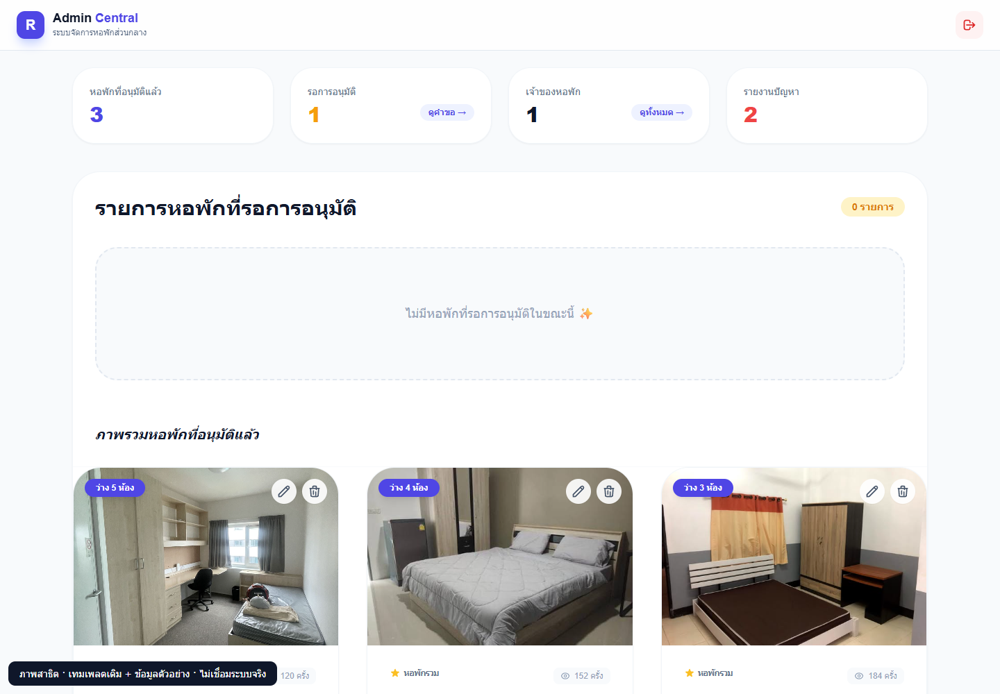

<details>
<summary>ภาพเพิ่มเติม: เข้าสู่ระบบ สมัครเจ้าของหอ เพิ่มหอ และตรวจคำขอ</summary>

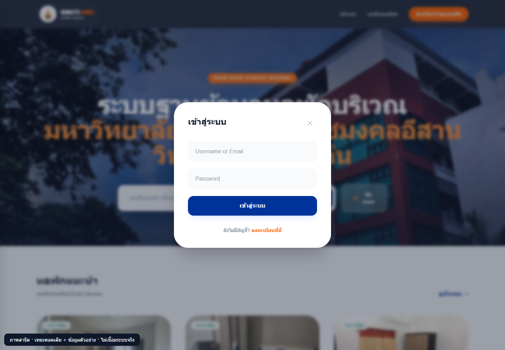
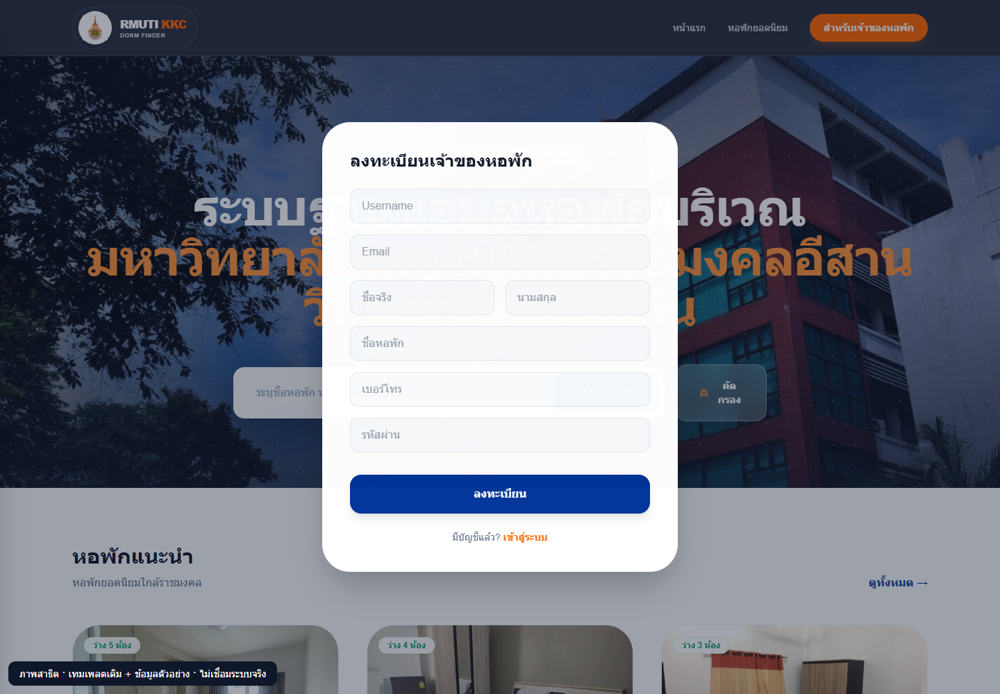
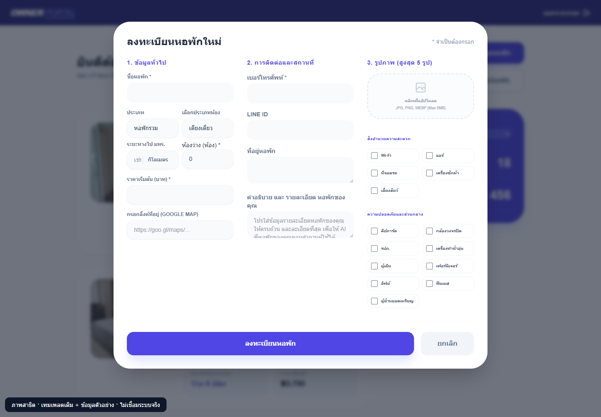
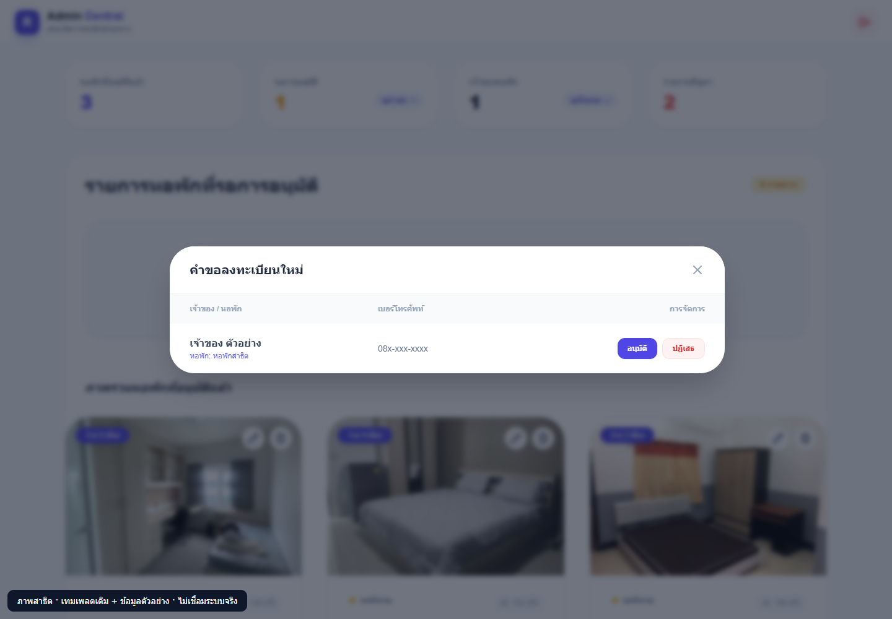

</details>

## โครงสร้างโปรเจกต์

```text
app/
  main.py             # FastAPI, routes, lifecycle และ business workflows
  auth.py             # Password hashing และ JWT helpers
  database.py         # Async SQLAlchemy engine และ session
  redis_conf.py       # Redis client และ retry
  schemas.py          # Request / response schemas
  models/             # User, dorm, draft, room, image, booking และ view log
ai/                   # Gemini intent, reranking, Q&A และ embedding script
services/             # Vector search, filtering, query cleaning และ ranking
templates/            # หน้า public, owner และ admin
static/js/            # JavaScript ของหน้าจอ
static/uploads/dorms/ # ไฟล์รูปหอพักและประเภทห้อง
search_api.py         # Router ของ /search/vector
routers/              # Debug router (ไม่ได้เปิดใช้งานใน main)
docs/                 # เอกสาร แผนภาพ และภาพสาธิต
docker-compose.yml    # backend + PostgreSQL/pgvector + Redis
```

## สถานะโปรเจกต์

โปรเจกต์เดิมที่นำมาจัดทำเอกสารสำหรับพอร์ต โดยรอบนี้เพิ่มเฉพาะ README และไฟล์ประกอบใน `docs/` **ไม่ได้แก้ไขโค้ดแอปพลิเคชัน**

เอกสารอ้างอิงจากซอร์สปัจจุบัน ยังไม่ได้ทดสอบระบบครบวงจรกับฐานข้อมูล Redis, SMTP และ Gemini จริง พบส่วนที่ต้องตรวจสอบก่อนนำกลับมาใช้งาน เช่น ชนิดข้อมูลคืนค่าของ semantic reranking, การเรียก vector search ใน router เก่า และการเตรียม embedding ให้ตรงกับ `Vector(768)`

ดูรายละเอียดโครงสร้าง หลักฐานจากไฟล์ และข้อจำกัดที่พบใน [บันทึกการวิเคราะห์ระบบ](docs/ARCHITECTURE.md)
